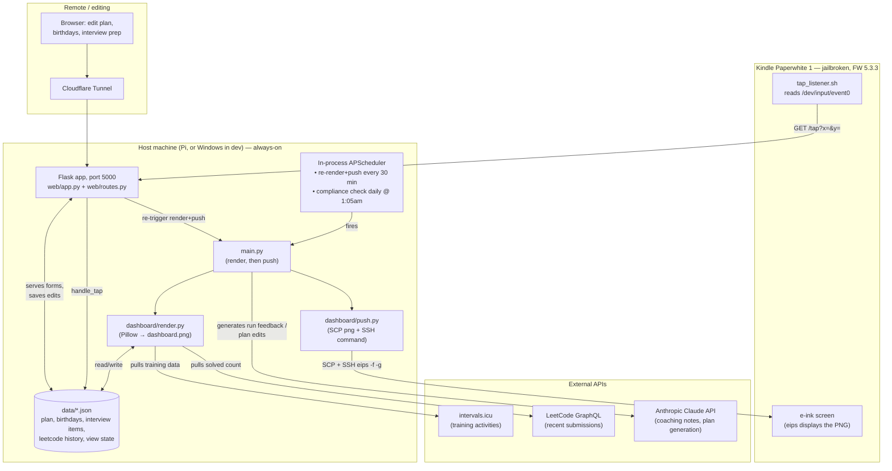

# Kindle Dashboard

A personal e-ink dashboard running on a jailbroken Kindle Paperwhite 1. A
Raspberry Pi renders a PNG (running plan + AI coaching, LeetCode/interview
prep tracking, upcoming birthdays) and pushes it to the Kindle over SSH every
30 minutes. Tapping the Kindle's touchscreen navigates between views —
there's no browser or reader UI involved, just a static image and a raw
touch-event listener.


<!-- TODO: replace with a real photo of the Kindle -->

## Why

I wanted a low-power, always-on screen next to my desk that shows the things
I actually check every day — today's run, whether I've done my LeetCode for
the day, whose birthday is coming up — without pulling out a phone. A
Kindle's e-ink screen is legible, doesn't need a backlight, and (once
jailbroken) is just a Linux box with a screen and a touch digitizer.

## Features

- **Running plan**: multi-week training plan, generated and edited via
  Claude from a short intake conversation; a daily job compares planned vs.
  actual mileage (via intervals.icu) and Claude writes a short post-run
  coaching note, optionally adjusting tomorrow's assigned run.
- **Interview prep tracking**: time-logged categories (system design, books,
  projects, LeetCode) with tap-to-log `+5/+15/+30` minute buttons directly on
  the Kindle.
- **LeetCode**: today's solved count, pulled from LeetCode's GraphQL API.
- **Birthdays**: upcoming birthdays surfaced on the dashboard.
- **Touch navigation**: tapping a section on the Kindle drills into a detail
  view (e.g. tapping the running section shows the full week); a raw
  touch-event listener on the Kindle posts tap coordinates back to the host.
- **Web UI**: a small Flask app (also the thing that renders/pushes the
  dashboard) for entering/editing plan, birthday, and interview-prep data
  from a browser, optionally exposed remotely via a Cloudflare Tunnel.

## Architecture



One process — the Flask app — does almost everything: it serves the web UI,
runs the in-process scheduler that triggers renders/pushes, and handles
incoming taps from the Kindle. `main.py` is the one-shot render+push path,
runnable standalone (`python main.py`) without the web server.

## Tech stack

- **Backend**: Flask, APScheduler (in-process background jobs), Paramiko
  (SSH/SCP to the Kindle)
- **Rendering**: Pillow (hand-drawn layout onto a 758×1024 canvas — the
  Kindle Paperwhite 1's native portrait resolution)
- **AI**: Anthropic Claude (training plan generation/editing, post-run
  coaching notes)
- **Data**: intervals.icu API (training history), LeetCode GraphQL API
  (submissions), flat JSON files for local state (no database)
- **Kindle side**: POSIX shell script reading raw Linux input events off
  `/dev/input/event0`, `eips` for e-ink refresh

## Setup

See [DEPLOY.md](DEPLOY.md) for the full setup story (host machine, SSH trust
with the Kindle, systemd service, Kindle-side tap listener, Cloudflare
Tunnel). Quick version:

```
git clone <this repo>
cd kindle
python -m venv .venv && source .venv/bin/activate
pip install -r requirements.txt
cp .env.example .env   # fill in Kindle host, API keys
python run.py          # Flask dev server on :5000, starts the scheduler
```

`python preview.py` renders the dashboard with mock data to `output/` without
needing a Kindle or any API keys — the fastest way to see the layout.

## Known limitations

- The Kindle-side tap listener doesn't survive a Kindle reboot (has to be
  restarted by hand over SSH) — see DEPLOY.md for why this hasn't been fixed.
- Runtime data (`data/*.json`) isn't checked into git, by design — a fresh
  clone starts with an empty dashboard.
